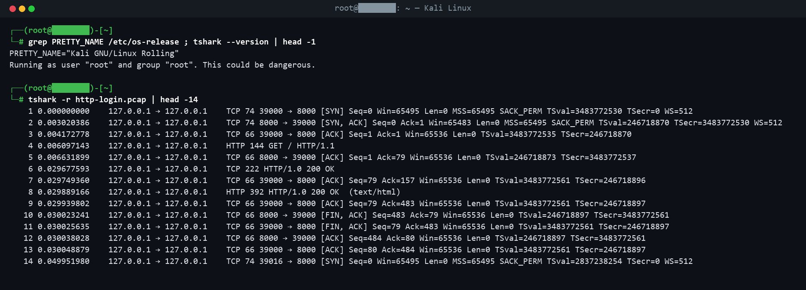
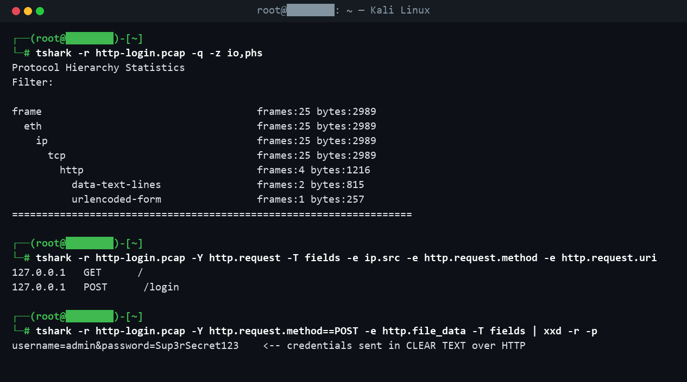

# Wireshark Traffic Analysis


A small, hands-on exercise in reading network traffic with **Wireshark / tshark**
on Kali Linux. I capture HTTP traffic on my own loopback, then analyse the capture
to show what a sniffer can see - including a login sent over plain HTTP.

> Ethical: everything is captured on my **own machine's loopback** (`127.0.0.1`).
> No external host is touched. Sniffing traffic you are not authorised to is illegal.

## What I did

1. Started a local web server on `127.0.0.1:8000`.
2. Captured the loopback interface with **tshark** while I made a page request and
   a login **POST**.
3. Analysed the saved capture: packet list, protocol hierarchy, HTTP requests, and
   the POST body.

The capture is included: [`captures/http-login.pcap`](captures/http-login.pcap) -
open it in Wireshark, or reproduce it with [`capture.sh`](capture.sh).

## Reading the capture

The TCP handshake, the HTTP `GET`, and the server's response, straight from tshark:



Protocol hierarchy, the HTTP requests, and the punchline - the login credentials
travelling in **clear text** because the site uses HTTP, not HTTPS:



## The tshark commands

```bash
# capture 10s of loopback traffic
tshark -i lo -w captures/http-login.pcap -a duration:10

# packet list
tshark -r captures/http-login.pcap | head -14

# protocol hierarchy
tshark -r captures/http-login.pcap -q -z io,phs

# every HTTP request (source, method, host, path)
tshark -r captures/http-login.pcap -Y http.request \
       -T fields -e ip.src -e http.request.method -e http.host -e http.request.uri

# the POST body - credentials in clear text
tshark -r captures/http-login.pcap -Y "http.request.method==POST" \
       -e http.file_data -T fields | xxd -r -p
```

In Wireshark's GUI the same thing is *Statistics → Protocol Hierarchy* and
right-click → *Follow → HTTP Stream*.

## What I understand from this

- How to **capture** on a specific interface and **read** a `.pcap` with tshark.
- The shape of a TCP connection (SYN / SYN-ACK / ACK) and where HTTP sits on top.
- **Protocol hierarchy** and **conversations** give a fast overview of a capture.
- **HTTP is clear text**: anyone on the path can read the URL *and* the POST body,
  so logins must go over HTTPS. This is the core reason TLS exists.

## Setup

```bash
sudo apt install -y tshark      # on Kali / Debian
./capture.sh                    # capture, then use the tshark commands above
```

---

Made by **Talha Aker**.
